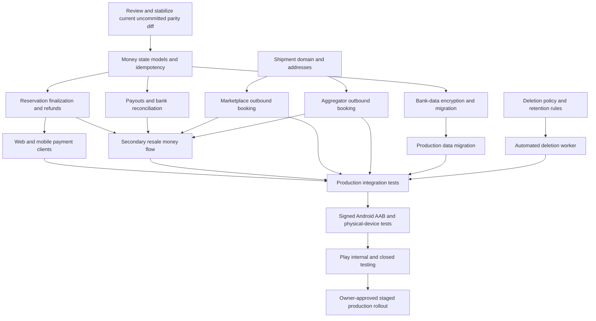

# GalleryZone production completion master plan

**Prepared:** 25 October 2026  
**Repository:** `D:\GZ\GZ-web`  
**Branch:** `feat/legal-update-oct2026`  
**Recorded HEAD:** `fa13585`  
**Android package:** `in.galleryzone.app`  
**Current app version:** `1.0.0+1`  
**Plan status:** Ready for owner review; implementation has not started from this plan

## 1. Purpose and current truth

This is the single execution plan for taking GalleryZone from its current local
web/mobile parity state to a production-ready website, backend, Android app, and
Google Play release.

The customer, artist, and aggregator mobile experiences have been brought into
line with the current website decisions, including the October 2026 legal/MOU
changes, removal of insurance, direct per-reservation Razorpay payment,
bank-based settlements, COA/NFC/passport features, pricing, public profiles,
blogs, art supplies, and shipping visibility. Those parity changes are currently
**uncommitted** and the working tree is broad.

That parity does **not** mean the product is production-complete. The most
important remaining items are shared backend and operational gaps, so they
affect both website and mobile. In particular, the Razorpay reservation race,
real refunds, outbound ShipRocket booking, payouts, bank-data encryption, and
automated deletion are not mobile-only issues.

Current evidence:

- `flutter analyze` passed with no issues.
- All 726 Flutter tests passed.
- The Android debug APK builds.
- A release AAB is correctly blocked because the private upload signing key is
  not available.
- Backend checks pass, including the 167-route contract check.
- The web production build passes; lint has 0 errors and 59 warnings.
- The focused aggregator-money browser suite passes 18/18 when run serially.
- The production privacy URL returned HTTP 200 on 25 October 2026.
- The production account-deletion URL returned HTTP 404 on 25 October 2026,
  even though its page exists locally.
- No production payment, refund, payout, shipment, deletion, NFC, email, or
  identity-verification evidence has been collected in this work.
- No commit, push, deployment, migration, credential change, Play upload, or
  external-service mutation is authorized by this plan.

## 2. Product decisions for the release

These decisions remove ambiguity during implementation:

1. **No GalleryZone wallet.** Customers and aggregators will not top up or
   withdraw from a product wallet. Payments are transaction-specific. Refunds
   return to the original payment source. Artist and aggregator earnings are
   settlement ledgers paid to verified bank accounts.
2. **The backend owns all money state.** Web and mobile must never independently
   decide that a payment, refund, reservation, or payout succeeded.
3. **Reserve inventory before opening payment.** The server will create a
   short-lived, idempotent reservation intent that prevents two aggregators from
   paying for the same artwork. A verified payment finalizes the holding. Any
   exceptional captured payment that cannot finalize must enter an automatic
   refund/reconciliation workflow.
4. **RazorpayX is the preferred payout adapter** if the GalleryZone account is
   approved for it. The adapter boundary must permit another bank/payout
   provider without changing settlement business rules. Admin approval alone
   is never recorded as money sent.
5. **ShipRocket bookings are server-authoritative.** A typed/manual tracking
   reference must never be displayed as a successfully booked courier shipment.
6. **Secondary resale must be complete or unavailable.** It will not remain as
   a seller-only promise in a public release. The plan completes discovery,
   payment, transfer, delivery, refund/dispute handling, and seller payout before
   enabling it in production.
7. **Google sign-in is out of scope for the first release.** Email/password is
   the supported authentication method. All store and marketing copy must agree.
8. **Collector bank withdrawals remain removed.** Legacy endpoints and admin
   controls must be retired or explicitly restricted so hidden old behavior
   cannot be used.
9. **Artist-to-artist connections are removed from the first release.** Both
   clients currently expose or reference a flow that has no backend routes. Hide
   the action and remove any promise; it can return in a separately specified
   release.
10. **No fake production data.** Mock repositories remain available only behind
    `GZ_MOCK=true` for development. Production builds use the deployed API and
    must not silently fall back to fixtures, demo AWBs, pretend payments, or
    placeholder company information.

## 3. Pending-work inventory

| ID | Priority | Scope | Pending item | Current state | Release treatment |
|---|---|---|---|---|---|
| P-01 | P0 | Shared | Aggregator reservation allocation race | Payment is verified before the holding is safely finalized | Replace with one idempotent server workflow |
| P-02 | P0 | Shared | Real Razorpay refunds and reconciliation | Internal ledger release exists; complete gateway refund flow does not | Refund to original source and reconcile webhooks/jobs |
| P-03 | P0 | Shared | Marketplace-to-buyer ShipRocket booking | Not automatically booked | Implement booking through delivery/RTO |
| P-04 | P0 | Shared | Aggregator-to-buyer ShipRocket booking | Not automatically booked | Implement booking through delivery/RTO |
| P-05 | P0 | Shared | Real artist/aggregator payouts | Approval creates ledger state only | Add payout provider, webhooks, UTR, reconciliation |
| P-06 | P0 | Backend/security | Bank-account encryption | `bankAccountEncrypted` can contain raw account data | Encrypt, rotate, migrate, mask, audit |
| P-07 | P0 | Shared/privacy | Automated account deletion | Support request and sign-out only | Add deletion state machine, worker, audit, processor cleanup |
| P-08 | P0 | Web/ops | Public deletion resource | Local page exists; production URL is currently 404 | Deploy and verify without authentication |
| P-09 | P0 | Shared | Secondary resale | Seller list/withdraw only | Complete end-to-end before enabling |
| P-10 | P1 | Shared | Wishlist and follows synchronization | Some state is device/browser-local | Store per account and sync across devices |
| P-11 | P1 | Shared | Notification preferences and delivery | Preferences are partly local; push is absent | Persist preferences and add transactional delivery |
| P-12 | P1 | Shared | Artist connections | UI/service references exist; backend routes do not | Remove from v1 web/mobile and promises |
| P-13 | P0 | Backend/data | Public-profile backfill | Script exists but has not been run in production | Dry-run, review, apply, verify, retain rollback evidence |
| P-14 | P0 | Legal/content | Terms placeholders and approvals | Grievance contact, address, CIN and approvals remain | Obtain real values and legal/finance sign-off |
| P-15 | P0 | Integrations | Production service configuration | Firebase, Razorpay, Cashfree, ShipRocket, storage, email and Sentry unproved | Configure outside Git and gather live evidence |
| P-16 | P0 | Android | Release signing and AAB | Private upload key is absent; no release AAB | Configure key, build, checksum, archive |
| P-17 | P0 | Android/web | App Links and signing fingerprints | Final Play App Signing fingerprint is unavailable | Configure Firebase and `assetlinks.json`; test installed app |
| P-18 | P0 | Play Console | Listing, declarations, access and testing | Owner-controlled forms/assets/testing remain | Complete internal/closed gates before production |
| P-19 | P1 | Quality | Web lint and full regression evidence | 59 warnings; only selected browser flow rerun during parity work | Triage warnings and execute the full matrix |
| P-20 | P1 | Device proof | Physical NFC and Android coverage | Native code builds; no physical-tag proof in this run | Test NFC/non-NFC devices and irreversible lock flow |
| P-21 | P1 | Operations | Cash remittance reconciliation | Aggregator can declare transfer; automated matching is absent | Capture bank reference and reconcile with dual control |
| P-22 | P1 | Backend/admin | Legacy withdrawal behavior | Old withdrawal routes/admin surfaces remain | Retire or migrate after payout model lands |
| P-23 | P1 | Content/operations | Placeholder/demo production content | Some team, analytics, affiliate, and explanatory surfaces still use demo/static data | Audit, replace, hide, or clearly label before launch |
| P-24 | P1 | Observability | Production monitoring and runbooks | Sentry/email/webhook behavior is unproved | Add alerts, dashboards, runbooks, and controlled test events |

`P0` means production release is blocked. `P1` means the item must either be
finished or deliberately removed/disabled before public rollout. None of these
items can be marked complete using UI screenshots or mocked tests alone.

## 4. Dependency order



The order is intentional: financial state, refunds, encryption, and shipping
must be reliable before clients and the resale flow are enabled; production
service evidence must exist before the Play release is promoted.

## 5. Execution plan

### Phase 0 — Stabilize the parity baseline

#### Task 0.1 — Review and classify the current working tree

**Scope:** Shared repository  
**Dependencies:** None  
**Estimated size:** M

Separate functional parity changes from mechanical Dart formatting, generated
model changes, release metadata, and documentation. Do not discard existing
work and do not create commits without owner authorization.

**Acceptance criteria:**

- [ ] Every modified/untracked file is assigned to a logical change group.
- [ ] Generated files match their source models and no unrelated user work is
  overwritten.
- [ ] Functional diffs for pricing, legal/MOU, payments, shipping, COA/NFC,
  content, and public profiles receive focused review.
- [ ] A proposed commit sequence is written down for owner approval.

**Verification:**

- [ ] `git diff --check` has no whitespace errors.
- [ ] Re-run backend check, web lint/build, Flutter analyze/test, and focused
  money-flow tests after review.

#### Task 0.2 — Establish release evidence and environment matrix

**Scope:** Documentation/operations  
**Dependencies:** Task 0.1  
**Estimated size:** S

Create a non-secret evidence index for local, staging, and production results.
Record environment, build SHA, app version, test account role, provider mode,
transaction/shipment identifiers, timestamps, and redacted evidence links.

**Acceptance criteria:**

- [ ] Local/mock, staging/sandbox, and production/live proof are visibly
  separated.
- [ ] No keys, tokens, bank numbers, Aadhaar data, or reviewer passwords are
  stored in Git.
- [ ] Each later task has a place to record its evidence and rollback result.

**Verification:**

- [ ] Review the evidence index with engineering, QA, finance, and operations;
  confirm that every P0 row has an owner and evidence target.

### Phase 1 — Make all money movement safe and real

#### Task 1.1 — Add a reservation-intent state model

**Scope:** Backend/contracts  
**Dependencies:** Task 0.1  
**Estimated size:** M

Create a reservation intent before opening Razorpay. It must bind the artwork,
aggregator, exact server-calculated amount, currency, expiry, idempotency key,
and Razorpay order. Use a database transaction or equivalent atomic guard so
only one active intent can control an artwork.

**Acceptance criteria:**

- [ ] Two aggregators cannot obtain payable control of the same artwork.
- [ ] Repeating the same idempotent request returns the same intent/order.
- [ ] Expired, cancelled, paid, refunded, and finalized states have explicit
  allowed transitions.
- [ ] Price and identity are never trusted from either client.

**Verification:**

- [ ] Unit/state-machine tests cover every transition and invalid transition.
- [ ] A concurrent test proves exactly one winner for the same artwork.
- [ ] Contract/route checks pass.

#### Task 1.2 — Finalize reservation payments idempotently

**Scope:** Backend/Razorpay  
**Dependencies:** Task 1.1  
**Estimated size:** M

Move verification and holding creation into one server-orchestrated workflow.
Process both the client verification callback and Razorpay webhooks as
idempotent inputs to the same state machine.

**Acceptance criteria:**

- [ ] One captured payment creates at most one holding and one ledger entry.
- [ ] Duplicate/out-of-order callbacks and webhooks are harmless.
- [ ] A crash after capture can be recovered by webhook or reconciliation job.
- [ ] Every terminal failure records an auditable reason and next action.

**Verification:**

- [ ] Tests inject duplicate, delayed, reordered, and replayed webhook events.
- [ ] Fault-injection tests stop between each persistence step and recover.
- [ ] Razorpay signature tests and backend build pass.

#### Task 1.3 — Implement automatic gateway refunds and reconciliation

**Scope:** Backend/jobs/Razorpay  
**Dependencies:** Task 1.2  
**Estimated size:** M

Create a common refund service for reservation-allocation failures, approved
order cancellations, eligible returns, and resale failures. Refund only to the
original payment source. Track requested, processing, processed, failed, and
manual-review states independently from internal ledger entries.

**Acceptance criteria:**

- [ ] An exceptional captured payment that cannot finalize is automatically
  queued for refund.
- [ ] Refund calls are idempotent and store the gateway refund ID.
- [ ] Webhooks and a scheduled reconciliation job converge local and Razorpay
  state without double-refunding.
- [ ] Users see accurate pending/completed/failed refund state on web and mobile.

**Verification:**

- [ ] Sandbox tests cover full, duplicate, failed, retried, and delayed refunds.
- [ ] An authorized low-value live payment and refund is proven before launch.
- [ ] Finance can reconcile gateway totals against orders, reservations,
  refunds, fees, and ledger entries.

#### Task 1.4 — Migrate web and mobile reservation clients

**Scope:** Web/mobile  
**Dependencies:** Tasks 1.1–1.3  
**Estimated size:** M

Both clients must consume the same intent/finalization contract, preserve the
intent across app background/resume, and display recoverable pending states.

**Acceptance criteria:**

- [ ] Web and mobile cannot call the old pay-then-create-holding sequence.
- [ ] Closing, backgrounding, retrying, or losing connectivity does not create
  a duplicate charge or reservation.
- [ ] The client can recover final state from the server after restart.
- [ ] Error copy distinguishes cancelled, failed, processing, and refunding.

**Verification:**

- [ ] Flutter repository/widget tests and Playwright money-flow tests pass.
- [ ] Manual browser and Android tests cover background/resume and poor network.

#### Task 1.5 — Implement a real payout adapter and reconciliation

**Scope:** Backend/admin/finance  
**Dependencies:** Task 1.1 and Task 3.1  
**Estimated size:** M

Add a provider-neutral payout adapter, initially backed by RazorpayX if the
account is approved. Separate settlement approval from payout creation,
processing, paid, reversed, failed, and manual-review states. Record provider
IDs and UTR/reference values.

**Acceptance criteria:**

- [ ] Only eligible, approved, non-duplicate settlements can be paid.
- [ ] The beneficiary is derived from the verified encrypted bank record.
- [ ] Provider webhook and scheduled reconciliation update final state.
- [ ] Failed/reversed payouts do not silently mark settlements as paid.
- [ ] Dual control is required for high-risk manual actions.

**Verification:**

- [ ] Adapter contract tests run without a live provider.
- [ ] Sandbox/provider tests cover success, duplicate, failure, reversal, and
  timeout.
- [ ] One authorized low-value payout is reconciled before launch.

#### Task 1.6 — Finish cash-remittance reconciliation and retire withdrawals

**Scope:** Backend/admin/web/mobile  
**Dependencies:** Task 1.5  
**Estimated size:** M

Capture bank reference/UTR, amount, sender, transfer time, proof metadata, and
review state for aggregator cash remittance. Remove or deny legacy collector
withdrawal routes and obsolete admin actions after migrating valid historical
records.

**Acceptance criteria:**

- [ ] A remittance declaration is not treated as received until reconciled.
- [ ] Duplicate UTR/reference submission is rejected or flagged.
- [ ] Legacy collector withdrawal entry points are absent from web and mobile
  and inaccessible through the API.
- [ ] Historical ledger data remains readable and auditable.

**Verification:**

- [ ] API authorization and migration tests prove retired routes cannot create
  new withdrawals and that remittance duplicate/reconciliation cases work.

**Checkpoint — money flows**

- [ ] Concurrent reservation test proves one winner and zero stranded charges.
- [ ] Customer, reservation, and resale refunds return to original payment
  methods.
- [ ] Payout and remittance states reconcile against external references.
- [ ] No wallet/top-up/collector-withdrawal wording or route remains active.

### Phase 2 — Complete real logistics

#### Task 2.1 — Define one shipment domain and address contract

**Scope:** Backend/contracts  
**Dependencies:** Task 0.1  
**Estimated size:** M

Model inbound artist-to-aggregator, marketplace-to-buyer, aggregator-to-buyer,
returns, and RTO using one shipment state machine. Store provider order ID,
shipment ID, AWB, courier, label, pickup, tracking history, NDR, cancellation,
and failure reason. Snapshot validated origin/destination addresses per shipment.

**Acceptance criteria:**

- [ ] Each order/holding has at most one active shipment for a direction.
- [ ] Manual references are visibly different from provider bookings.
- [ ] Webhook events are idempotent and cannot move state backwards incorrectly.
- [ ] PII is excluded from logs and unauthorized API responses.

**Verification:**

- [ ] State-machine, authorization, DTO privacy, duplicate-webhook, and address
  snapshot tests pass.

#### Task 2.2 — Book marketplace-to-buyer shipments

**Scope:** Backend/customer/artist clients  
**Dependencies:** Task 2.1 and successful customer payment  
**Estimated size:** M

Book ShipRocket after the order satisfies payment, artwork, packaging, address,
and dispatch gates. Provide label/pickup workflow to the authorized fulfiller and
tracking to the buyer.

**Acceptance criteria:**

- [ ] A paid eligible marketplace order creates one real ShipRocket order.
- [ ] Failed booking remains retryable and never fabricates an AWB.
- [ ] Buyer and fulfiller see the same normalized shipment state.
- [ ] Cancellation before pickup invokes provider cancellation when allowed.

**Verification:**

- [ ] Contract tests cover successful, duplicate, failed, retried, and cancelled
  bookings; an authorized provider booking is tracked through delivery.

#### Task 2.3 — Book aggregator-to-buyer shipments

**Scope:** Backend/aggregator/customer clients  
**Dependencies:** Task 2.1 and recorded/verified aggregator sale  
**Estimated size:** M

Create the outbound booking from the holding location after sale validation and
cash/online payment rules pass. Preserve the existing inbound shipment as a
separate record.

**Acceptance criteria:**

- [ ] Inbound and outbound AWBs cannot overwrite each other.
- [ ] Only the authorized aggregator/admin can request dispatch.
- [ ] Buyer address, parcel details, declared value, and pickup location are
  server validated.
- [ ] Commission/settlement waits for the defined delivery/return gate.

**Verification:**

- [ ] Tests prove inbound/outbound separation, role checks, duplicate booking
  prevention, and settlement gating; verify one authorized provider booking.

#### Task 2.4 — Complete tracking, NDR, return, and cancellation operations

**Scope:** Backend/jobs/web/mobile/admin  
**Dependencies:** Tasks 2.2–2.3  
**Estimated size:** M

Consume ShipRocket webhooks, poll/reconcile missing events, support pickup and
booking cancellation, record NDR actions and RTO, and surface actionable errors.

**Acceptance criteria:**

- [ ] Booking, label, pickup, in-transit, delivered, NDR, cancelled, and RTO are
  represented consistently on both clients.
- [ ] Duplicate/out-of-order webhooks are safe.
- [ ] A reconciliation job identifies stuck or divergent shipments.
- [ ] Operations has a retry/manual-review queue with an audit trail.

**Verification:**

- [ ] Replay recorded webhook fixtures in and out of order, run reconciliation,
  and demonstrate booking failure, cancellation, NDR, delivery, and RTO states.

**Checkpoint — logistics**

- [ ] Inbound, both outbound paths, cancellation, failed booking, NDR, delivery,
  and RTO are proven in the authorized provider environment.
- [ ] No demo AWB or manually advanced status is presented as provider truth.

### Phase 3 — Protect financial data and automate privacy obligations

#### Task 3.1 — Encrypt bank-account data and migrate existing records

**Scope:** Backend/security/data  
**Dependencies:** Task 0.2  
**Estimated size:** M

Use envelope encryption with a managed KMS or equivalent secret-managed master
key. Store ciphertext, key version, non-sensitive account fingerprint for
duplicate detection, and the last four digits for display. Never expose full
numbers after initial entry.

**Acceptance criteria:**

- [ ] No new raw account number is stored in Firestore/database fields, logs,
  traces, analytics, errors, or client caches.
- [ ] Read access is least-privilege and audited.
- [ ] The migration is resumable, idempotent, count-checked, and has a tested
  rollback/restore procedure.
- [ ] Key rotation can rewrap records without changing business identity.

**Verification:**

- [ ] Tests prove encryption/decryption, masking, authorization, rotation, and
  migration restart.
- [ ] A production scan/report confirms no known raw legacy values remain.

#### Task 3.2 — Build the account-deletion state machine and worker

**Scope:** Backend/auth/storage/privacy  
**Dependencies:** Approved retention rules in Task 4.5  
**Estimated size:** M

Replace the support-only request with a traceable deletion workflow covering
Firebase Authentication, profile/private data, uploaded files, support/content
records, processor data, notifications, and legally retained transaction
records. Retained records must be minimized and de-identified where lawful.

**Acceptance criteria:**

- [ ] An authenticated user can request deletion in-app and receives a request
  ID/status.
- [ ] The public web resource can initiate or explain deletion without requiring
  app installation.
- [ ] A retryable worker completes all processors and records an audit trail.
- [ ] Failed processor cleanup enters an operations queue; it is not silently
  considered complete.
- [ ] The user receives confirmation and can no longer authenticate afterward.

**Verification:**

- [ ] Automated fault tests retry each processor safely; delete a disposable
  account in the authorized environment and verify every processor and audit row.

#### Task 3.3 — Harden credentials, webhooks, authorization, and PII logging

**Scope:** Backend/web/mobile/security  
**Dependencies:** Tasks 1.2, 1.5, 2.4, and 3.1  
**Estimated size:** M

Review role/ownership authorization, webhook signatures and replay protection,
rate limits, request limits, CORS, upload validation, secret loading, production
fail-closed behavior, and redaction across logs/Sentry.

**Acceptance criteria:**

- [ ] Simulated payments and mock data cannot activate in production.
- [ ] Each webhook verifies the correct independent secret and prevents replay.
- [ ] Cross-account access tests fail for customer, artist, aggregator, and
  admin resources.
- [ ] Secrets and sensitive identity/financial data are absent from client
  bundles and telemetry.

**Verification:**

- [ ] Run focused authorization/replay/redaction tests and an approved security
  review of the final diff and production configuration.

**Checkpoint — security and privacy**

- [ ] Bank data is encrypted and migrated.
- [ ] A real test account is deleted across the documented processors.
- [ ] The public deletion URL returns 200 without authentication.
- [ ] Security/authorization tests and redaction review pass.

### Phase 4 — Close or remove incomplete product features

#### Task 4.1 — Complete secondary resale end to end

**Scope:** Backend/web/mobile/payments/shipping  
**Dependencies:** Tasks 1.3, 1.5, 2.2, 2.4, and 3.1  
**Estimated size:** M per sub-slice

Deliver this as small vertical slices: listing moderation and availability;
buyer discovery; server-priced checkout; payment and refund; outbound shipping;
delivery/dispute window; ownership transfer; seller payout; cancellation and
audit. Keep the production feature disabled until all slices pass.

**Acceptance criteria:**

- [ ] A buyer can discover and buy an eligible resale artwork only once.
- [ ] Payment, refund, shipping, ownership, fees/tax, and seller settlement are
  one auditable lifecycle.
- [ ] Failed/cancelled/returned sales never transfer ownership or pay the seller
  incorrectly.
- [ ] Web and mobile expose identical supported states and policies.

**Verification:**

- [ ] Automated and role-based tests cover duplicate buyers, payment failure,
  refund, return, dispute, delivery, ownership transfer, and seller payout.

#### Task 4.2 — Synchronize wishlist, follows, and preferences

**Scope:** Backend/web/mobile  
**Dependencies:** Task 0.1  
**Estimated size:** M

Replace device-only state for authenticated users with account-scoped APIs and
an explicit anonymous-to-account merge policy.

**Acceptance criteria:**

- [ ] Changes appear across web and a second mobile device after sign-in.
- [ ] Unauthenticated usage remains safe and merges deterministically.
- [ ] Deleting an account removes the synchronized data.

**Verification:**

- [ ] API/client tests cover anonymous merge, conflicts, multi-device refresh,
  authorization, and deletion cleanup.

#### Task 4.3 — Implement transactional notifications

**Scope:** Backend/jobs/mobile/web/email  
**Dependencies:** Task 4.2 and production Firebase/Resend  
**Estimated size:** M

Persist notification preferences and device tokens. Send only defined
transactional events such as payment/refund, reservation, shipment, payout,
verification, MOU, support, ownership, and security changes. Use an outbox/job
model so transaction success is not coupled to delivery success.

**Acceptance criteria:**

- [ ] Preferences synchronize and are enforced by channel/event type.
- [ ] Invalid/revoked device tokens are retired.
- [ ] Delivery retries are bounded, deduplicated, observable, and auditable.
- [ ] Critical events retain an in-app/email fallback where required.

**Verification:**

- [ ] Outbox, preference, deduplication, retry, token-expiry, and provider-failure
  tests pass; controlled email/push events arrive on approved test devices.

#### Task 4.4 — Remove unsupported v1 features and obsolete behavior

**Scope:** Shared  
**Dependencies:** Task 0.1  
**Estimated size:** M

Remove artist-connection actions and promises, collector withdrawal behavior,
obsolete wallet/subscription/insurance copy, and any Google-sign-in promise.
Keep backwards-compatible database readers only where historical data requires
them; prevent creation of new obsolete records.

**Acceptance criteria:**

- [ ] No production action ends with “coming soon” because its backend is absent.
- [ ] Hidden legacy endpoints return an intentional retired/forbidden response.
- [ ] Store listing, FAQ, legal text, website, and mobile all describe the same
  supported product.

**Verification:**

- [ ] Repository search and route tests find no active obsolete entry point or
  unsupported promise; role smoke tests confirm intentional retired responses.

#### Task 4.5 — Finalize legal, finance, and company content

**Scope:** Legal/finance/web/mobile/store  
**Dependencies:** Final money, payout, resale, deletion, and retention behavior  
**Estimated size:** M

Provide the real grievance officer/contact process, grievance email, postal and
registered-office addresses, response timeline, company CIN, tax/TDS/GST
wording, refund/return rules, resale terms, payout timing, data retention,
affiliate disclosure, and MOU signatory details. Obtain recorded approvals.

**Acceptance criteria:**

- [ ] No `[Insert ...]`, placeholder person/address, or unapproved legal value
  remains on web, mobile, generated PDFs, or store documents.
- [ ] Terms, privacy, Artist MOU, Aggregator MOU, FAQ, and Data Safety statements
  agree with implemented behavior.
- [ ] Legal and finance owners record version/date approval.

**Verification:**

- [ ] Run a cross-surface legal-text comparison and obtain recorded legal and
  finance approval against the exact release revision.

#### Task 4.6 — Audit production content and data provenance

**Scope:** Web/mobile/admin/content  
**Dependencies:** Task 0.1  
**Estimated size:** M

Review team biographies/images, dashboard analytics, public counts, blog/supply
catalogue, affiliate links, contact details, demo accounts, stock imagery, and
empty-state text. Replace with approved data, derive it from real APIs, hide it,
or label it truthfully.

**Acceptance criteria:**

- [ ] No fixture identity, invented metric, fake testimonial, or demo shipment
  appears in production mode.
- [ ] Affiliate content is approved, current, attributable, and disclosed.
- [ ] Empty data produces a real empty state rather than seeded production data.

**Verification:**

- [ ] Run production-mode content/API smoke tests with empty and populated test
  accounts, plus an approved human content review.

#### Task 4.7 — Run and verify the public-profile backfill

**Scope:** Backend/data/operations  
**Dependencies:** Approved profile schema and production backup  
**Estimated size:** S

Run `npm run backfill:public-artists -- --dry-run`, review counts and samples,
then run the explicit apply mode against the intended environment during an
approved window.

**Acceptance criteria:**

- [ ] Dry-run count matches reviewed source records.
- [ ] Only public-safe fields are written.
- [ ] Apply counts, errors, and representative profiles are recorded.
- [ ] Private KYC, bank, contact, and identity fields are not exposed.

**Verification:**

- [ ] Compare dry-run/apply counts, inspect representative public responses as
  signed-out users, and run the public-profile privacy checks.

**Checkpoint — product truth**

- [ ] Every visible feature is either fully backed by production services or
  deliberately removed/disabled.
- [ ] Resale, synchronized state, and notifications pass web/mobile tests.
- [ ] Legal and public content matches actual behavior.

### Phase 5 — Configure and prove the production environment

#### Task 5.1 — Deploy reviewed backend and web builds

**Scope:** Operations/backend/web  
**Dependencies:** Phases 1–4 and owner deployment authorization  
**Estimated size:** M

Deploy immutable reviewed revisions with `NODE_ENV=production` and
`PAYMENTS_MODE=razorpay`. Configure CORS and canonical API/site URLs. Run
database migrations/backfills separately with backups and rollback steps.

**Acceptance criteria:**

- [ ] Production refuses simulated payment endpoints and partial ShipRocket
  configuration.
- [ ] Health/readiness checks validate required dependencies without exposing
  secrets.
- [ ] `https://www.galleryzone.art/privacy` and `/account-deletion` are public.
- [ ] The deployed build SHA and environment configuration are recorded.

**Verification:**

- [ ] Run readiness, public-page, production-mode, CORS, and role smoke tests
  against the deployed URLs; exercise and verify the rollback procedure.

#### Task 5.2 — Prove Firebase authentication

**Scope:** Firebase/web/mobile  
**Dependencies:** Task 5.1  
**Estimated size:** S

Configure the production Android app, authorized domains, email templates, and
signing fingerprints. Verify registration, email verification, sign-in, token
refresh, reset, sign-out, disabled/deleted account, and role reconciliation.

**Acceptance criteria:**

- [ ] Web and Play-installed Android builds complete every supported auth flow.
- [ ] Expired, revoked, disabled, deleted, and wrong-role sessions fail safely.
- [ ] Email links return users to the correct verified production surface.

**Verification:**

- [ ] Record redacted role-by-role auth results on web and physical Android,
  including reset links, token refresh, and deleted-account denial.

#### Task 5.3 — Prove Razorpay payments, refunds, and webhooks

**Scope:** Razorpay/backend/web/mobile  
**Dependencies:** Phase 1 and Task 5.1  
**Estimated size:** M

Configure separate live API and webhook secrets outside Git. Use authorized
low-value physical-goods transactions to prove customer checkout, aggregator
reservation, cancellation, automatic refund, duplicate webhook handling,
reconciliation, and app background/resume.

**Acceptance criteria:**

- [ ] Customer and aggregator payment records match Razorpay orders/payments.
- [ ] Duplicate or missed client callbacks converge through webhook/reconciliation.
- [ ] Authorized cancellations and exceptional reservation failures refund once.

**Verification:**

- [ ] Reconcile redacted live order, payment, webhook, refund, and local ledger
  identifiers for approved low-value tests on web and Android.

#### Task 5.4 — Prove Cashfree Secure ID verification

**Scope:** Cashfree/backend/web/mobile  
**Dependencies:** Task 5.1  
**Estimated size:** S

Configure production credentials and exactly one supported 2FA mechanism. Test
approved identities only, including GSTIN, DigiLocker callback, expiry,
cancellation, failure, retry, webhook/signature, and data minimization.

**Acceptance criteria:**

- [ ] Both verification flows use production credentials and required 2FA.
- [ ] Failure, expiry, cancellation, replay, and callback mismatch are safe.
- [ ] Clients receive only the minimum verification result required.

**Verification:**

- [ ] Save redacted provider and application results for approved successful and
  failed tests; rerun signature and authorization checks.

#### Task 5.5 — Prove ShipRocket end to end

**Scope:** ShipRocket/backend/web/mobile  
**Dependencies:** Phase 2 and Task 5.1  
**Estimated size:** M

Configure production credentials, pickup nickname, and independent webhook
secret. Prove inbound plus both outbound paths, label, pickup, all tracking
stages, booking failure, cancellation, NDR, RTO, and reconciliation.

**Acceptance criteria:**

- [ ] Provider IDs, AWBs, labels, tracking events, and local shipment records
  reconcile for all three directions.
- [ ] Failure/retry/cancellation/NDR/RTO states are actionable and auditable.
- [ ] No synthetic or manually typed record is labelled as provider booked.

**Verification:**

- [ ] Save redacted booking/webhook/tracking evidence and run the shipment
  reconciliation report for controlled production shipments.

#### Task 5.6 — Prove storage, email, Sentry, and scheduled jobs

**Scope:** Operations  
**Dependencies:** Task 5.1  
**Estimated size:** M

Verify image/file upload authorization, content limits, signed/public access as
designed, email delivery and bounce ownership, controlled Sentry events with
source maps/releases, and production schedules for refund, payment, shipment,
payout, deletion, and notification reconciliation.

**Acceptance criteria:**

- [ ] Authorized files can be stored/read and unauthorized access is denied.
- [ ] Email success/bounce and Sentry release/event ownership are proven.
- [ ] Every scheduled job has locking, retry, alert, and manual-recovery behavior.

**Verification:**

- [ ] Execute controlled upload, email, Sentry, duplicate-run, failure, and alert
  tests; record redacted evidence and operations ownership.

#### Task 5.7 — Publish and verify Android App Links

**Scope:** Android/Firebase/web  
**Dependencies:** Play App Signing fingerprint and Task 5.1  
**Estimated size:** S

Add the Play App Signing SHA-256 fingerprint to Firebase and production
`/.well-known/assetlinks.json`. Ensure `/verify/<id>` opens the installed app and
falls back safely to the website when the app is absent.

**Acceptance criteria:**

- [ ] The production association file contains only approved package/fingerprint
  values and is publicly reachable with the correct content type.
- [ ] A Play-delivered app opens valid verification links directly.
- [ ] Invalid/missing IDs and app-not-installed cases fail safely on the web.

**Verification:**

- [ ] Validate the association file and test links on physical Android with the
  app installed, uninstalled, signed in, and signed out.

**Checkpoint — production integrations**

- [ ] Every service in the integration truth table has dated, redacted,
  production evidence.
- [ ] Failed and replayed callbacks are tested, not only happy paths.
- [ ] Alerts and operational ownership exist for every reconciliation queue.

### Phase 6 — Complete release-quality validation

#### Task 6.1 — Clear static-analysis and code-quality debt

**Scope:** Shared  
**Dependencies:** Implementation complete  
**Estimated size:** M

Re-run and fix actionable Flutter, TypeScript, ESLint, React hook/compiler,
accessibility, image optimization, generated-code, and dependency warnings.
Document any intentionally accepted warning with owner and reason.

**Acceptance criteria:**

- [ ] Flutter analyze has zero issues.
- [ ] Backend type/build/check suite passes.
- [ ] Web lint has zero errors and no unexplained warnings.
- [ ] Dependency/security review has no unresolved release-blocking finding.

**Verification:**

- [ ] Save command output and the reviewed exception list against the exact
  release revision.

#### Task 6.2 — Run full automated regression suites

**Scope:** Shared  
**Dependencies:** Task 6.1  
**Estimated size:** M

Run backend checks plus focused integration tests, all Flutter tests, web build,
and all Playwright smoke/functional/responsive/accessibility suites serially or
with proven stable concurrency.

**Acceptance criteria:**

- [ ] All suites pass from a clean checkout with documented commands.
- [ ] Payment, refund, payout, shipment, deletion, resale, ownership, COA/NFC,
  MOU, identity, and authorization regressions are covered.
- [ ] Flaky/time-out results are investigated rather than hidden by reruns.

**Verification:**

- [ ] Execute all documented clean-checkout commands and archive machine-readable
  reports plus failures/retries with root-cause notes.

#### Task 6.3 — Execute role-by-role end-to-end acceptance

**Scope:** Production-like environment  
**Dependencies:** Phase 5  
**Estimated size:** M

Use separate customer, artist, aggregator, and admin accounts. Verify onboarding,
verification, MOU, artwork creation/approval, marketplace purchase, reservation,
both fulfillment paths, refund/return, payout/remittance, COA/NFC/passport,
ownership, resale, support, notifications, and deletion.

**Acceptance criteria:**

- [ ] Each role completes its happy path and defined failure/recovery paths.
- [ ] Cross-role and cross-account access is denied.
- [ ] External provider identifiers reconcile with application state.

**Verification:**

- [ ] QA and the relevant business owner sign the dated acceptance matrix with
  redacted evidence for each role and flow.

#### Task 6.4 — Test Android devices and lifecycle conditions

**Scope:** Mobile/device  
**Dependencies:** Signed candidate build  
**Estimated size:** M

Test Android 10 through 16 where available, compact/mid/large screens, low- and
mid-memory devices, NFC and non-NFC hardware, camera/file picker, rotation,
background/resume during payment, deep links, offline/poor network, interrupted
uploads, permission denial, upgrade, reinstall, and accessibility settings.

**Acceptance criteria:**

- [ ] The irreversible NTAG213 lock flow is proven on spare physical tags,
  including read, write, lock, already-locked, wrong-tag, and recovery paths.
- [ ] Non-NFC devices degrade cleanly.
- [ ] No critical crash, ANR, inaccessible blocker, data loss, or duplicate
  money action remains.

**Verification:**

- [ ] Record device/OS/build results, Play pre-launch results, accessibility
  checks, and NFC tag evidence in the release evidence index.

#### Task 6.5 — Rehearse migration, rollback, backup, and incident runbooks

**Scope:** Operations  
**Dependencies:** Final schemas/jobs  
**Estimated size:** M

Rehearse database/index changes, bank encryption migration, profile backfill,
job pausing, previous-build rollback, webhook replay/reconciliation, provider
outage handling, and data restore in a non-production environment.

**Acceptance criteria:**

- [ ] Each migration can resume safely and reports expected/actual counts.
- [ ] Previous application versions and backed-up data can be restored within
  the approved recovery objectives.
- [ ] Every financial/logistics/privacy queue has a provider-outage runbook.

**Verification:**

- [ ] Execute a timed rehearsal, record recovery results and gaps, then repeat
  until the approved objectives are met.

### Phase 7 — Build and release through Google Play

#### Task 7.1 — Prepare the signed Android release artifact

**Scope:** Android/owner  
**Dependencies:** Phase 6  
**Estimated size:** S

Accept Android SDK licenses, create/secure/back up the private upload keystore,
configure ignored `android/key.properties`, and set a Play-unused version code.
Never store the private key or passwords in Git.

Run from `mobile/`:

```powershell
flutter clean
flutter pub get
flutter analyze
flutter test
flutter build appbundle --release
```

**Acceptance criteria:**

- [ ] Release AAB is signed only by the approved upload key.
- [ ] AAB, mapping file, native debug symbols, checksums, build SHA, Flutter/Dart
  versions, and dependency lockfiles are archived.
- [ ] The final bundle uses the production API and cannot enable `GZ_MOCK`.

**Verification:**

- [ ] Inspect the final bundle/configuration, verify signing certificates and
  checksums, and install the exact AAB through Play internal testing.

#### Task 7.2 — Finish Play listing and policy declarations

**Scope:** Play Console/legal/owner  
**Dependencies:** Final production behavior and Task 7.1  
**Estimated size:** M

Complete the Data Safety form from verified SDK/provider behavior, privacy and
deletion URLs, App access, content rating, ads, target audience, government-app,
financial-feature, physical-goods payment, and any other current declarations.
Provide durable redacted reviewer accounts for customer, artist, and aggregator.

**Acceptance criteria:**

- [ ] All declarations match the exact final bundle, SDKs, data flows, and
  processor contracts.
- [ ] Reviewer accounts remain usable for the review period without real PII.
- [ ] Store copy/screenshots contain no unsupported or incomplete feature claim.

**Assets:**

- [ ] Approved 512 × 512 Play icon.
- [ ] Approved 1024 × 500 feature graphic.
- [ ] At least two real, current, redacted phone screenshots; use a broader set
  covering the three roles if possible.
- [ ] Final title, short/full descriptions, release notes, support email, and
  website.

**Verification:**

- [ ] A second owner reviews the Play preview, declarations, URLs, credentials,
  and asset dimensions before submission.

#### Task 7.3 — Internal, closed, and staged production testing

**Scope:** Play Console/QA/owner  
**Dependencies:** Tasks 7.1–7.2  
**Estimated size:** M

Upload to internal testing first and install the Play-delivered build. Review
pre-launch crashes, ANRs, accessibility, security, bundle warnings, device
coverage, and policy status. If the developer account is subject to the current
personal-account gate, maintain at least 12 opted-in testers continuously for 14
days before applying for production access. Recheck the rule in Play Console at
release time.

Promote only after owner approval using a monitored staged rollout with halt and
rollback criteria.

**Acceptance criteria:**

- [ ] Internal and required closed testing complete without unresolved P0/P1
  issues.
- [ ] Production access and every declaration are approved in Play Console.
- [ ] Rollout monitoring covers crashes, ANRs, API errors, payments, refunds,
  shipments, payouts, auth, deletion, and support contacts.
- [ ] No production promotion occurs without explicit owner approval.

**Verification:**

- [ ] Install the Play-delivered artifact, complete the release test matrix, and
  save Play review/pre-launch/rollout evidence against its version code.

## 6. Required verification matrix

| Flow | Local automated | Sandbox/staging | Authorized production proof |
|---|---:|---:|---:|
| Customer Razorpay checkout | Required | Required | Required |
| Aggregator Razorpay reservation | Required | Required | Required |
| Allocation-race auto-refund | Required concurrent/fault tests | Required | Required low-value proof |
| Cancellation/return refund | Required | Required | Required low-value proof |
| Artist/aggregator payout | Required adapter tests | Required | Required low-value proof |
| Cash remittance reconciliation | Required | Required | Required controlled proof |
| ShipRocket inbound | Required | Required if available | Required |
| Marketplace outbound | Required | Required if available | Required |
| Aggregator outbound | Required | Required if available | Required |
| NDR/RTO/cancellation | Required | Required if available | Required controlled proof |
| Firebase auth lifecycle | Required | Required | Required test-account proof |
| Cashfree GSTIN/DigiLocker | Required signatures/contracts | Required | Required approved-identity proof |
| Bank encryption/migration | Required | Required rehearsal | Required count/redaction report |
| Account deletion | Required worker tests | Required | Required disposable-account proof |
| Resale lifecycle | Required | Required | Required low-value/controlled proof |
| NFC read/write/lock | Required mocks/unit | Physical device | Physical production-build proof |
| App Links | Required config tests | Signed app test | Play-delivered app proof |

## 7. Release definition of done

GalleryZone is ready for a public Play release only when all conditions below
are true:

- [ ] Every P0 item is complete with evidence; every P1 item is complete or has
  been deliberately removed/disabled and documented.
- [ ] Website and mobile consume the same production API contracts and business
  rules for pricing, legal/MOU, payment, refund, shipping, settlement, resale,
  ownership, COA/NFC, verification, and deletion.
- [ ] No captured payment can be stranded because of an allocation race.
- [ ] Refunds return to the original gateway source and reconcile.
- [ ] Marketplace and aggregator buyer deliveries create real courier bookings.
- [ ] Approved settlements execute and reconcile as actual payouts.
- [ ] Full bank account numbers are encrypted and absent from logs/client data.
- [ ] Account deletion works across authentication, application data, files,
  processors, and legally defined retention.
- [ ] Production Firebase, Razorpay, Cashfree, ShipRocket, storage, Resend,
  Sentry, webhooks, jobs, domains, and alerts are verified.
- [ ] Privacy and deletion pages are publicly reachable; legal/finance approvals
  are recorded.
- [ ] Full automated, role-based, resilience, accessibility, security, migration,
  and physical-device/NFC tests pass.
- [ ] A signed release AAB is reproducibly built and installed from Play's
  internal track.
- [ ] Data Safety, App access, content rating, declarations, store assets, and
  required closed testing are accepted by Play Console.
- [ ] The owner explicitly approves staged production rollout.

## 8. Owner-controlled inputs and approvals

Engineering can prepare code and tests, but the following require authorized
owner action or credentials:

- Play upload keystore creation, secure backup, and passwords.
- Play Console access, unused version code confirmation, Play App Signing
  fingerprint, tester management, declarations, and rollout approval.
- Production Firebase, Razorpay/RazorpayX, Cashfree Secure ID, ShipRocket,
  storage, Resend, Sentry, hosting, DNS, and webhook credentials/configuration.
- Provider account activation, commercial approval, and low-value live-test
  authorization.
- Legal values and approval for company identity, grievance process, retention,
  refunds/returns, resale, GST/TDS, affiliate disclosures, privacy, terms, and
  both MOUs.
- Finance approval for payout timing, reconciliation controls, settlement
  reports, and exception handling.
- Approved test identities, reviewer accounts, real store graphics, support
  ownership, and production incident contacts.
- Explicit permission for commits, pushes, deployments, migrations, live
  payments/refunds/payouts, external-service changes, and Play uploads.

## 9. Recommended work sequence

1. Review this plan and authorize the implementation scope.
2. Stabilize and review the existing uncommitted parity work.
3. Complete reservation idempotency, refunds, payouts, and bank encryption.
4. Complete both outbound ShipRocket paths and operational reconciliation.
5. Automate deletion and finish/hide every incomplete product surface.
6. Complete resale, synchronized user state, and notifications.
7. Finalize legal/content and run approved production migrations/backfills.
8. Deploy to an authorized production/staging environment and collect real
   integration evidence.
9. Run the full automated, role, device, NFC, accessibility, security, and
   recovery matrix.
10. Build the signed AAB, complete Play Console work, test through Play, and
    promote with explicit owner approval and staged monitoring.

Until this definition of done is met, describe the repository as a **locally
validated web/mobile parity candidate**, not a fully live, production-ready app.
